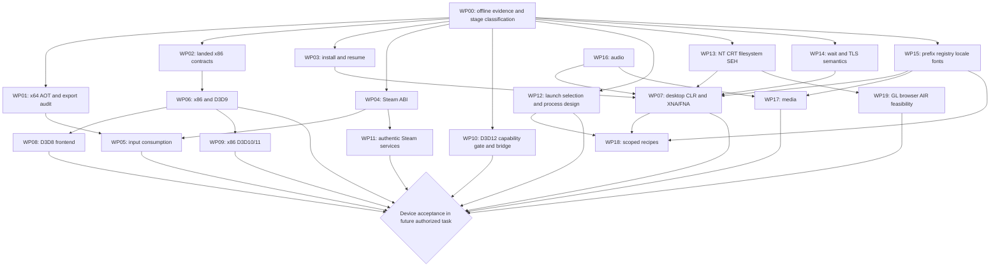

# Proton-to-Nativra port plan

**Resumo (pt-BR).** A prioridade é fechar contratos compartilhados já observados: auditar o restante da falha de marshalling do build 502, validar os seis bloqueios x86 já corrigidos, tornar downloads recuperáveis, corrigir a ABI Steam que derruba Dokimon e completar a entrada de Cuphead. Depois vêm maturidade x86/D3D9, .NET/XNA/FNA, D3D8 e D3D12 nativo. DXVK/vkd3d-proton são referências de comportamento e testes; o destino usa D3D11/D3D12, sem precisar de Vulkan. O Xbox UWP expõe limites de recursos e feature level que impedem prometer todos os jogos do Proton. Hades já recebeu a correção de ponteiros e foi confirmado jogável; Cuphead já recebe XInput, mas ainda não há navegação comprovada. Este trabalho só pesquisou e escreveu documentação: nenhum acesso ao console, login ou mudança de código.

Baseline: Nativra `58c768e`, research date **2026-10-24**. This is a ranked implementation backlog, not a new compatibility result. Read alongside [the earlier parity matrix](PROTON-PARITY.md), [measured compatibility](COMPATIBILITY.md), [measured blockers](BLOCKERS.md), [the library catalog](LIBRARY.md) and [architecture](ARCHITECTURE.md). The catalog is an October 1 planning snapshot; newer measured rows take precedence over its obsolete statements that Cuphead, WAVESHAPER and Super Meat Boy have never rendered.

## Evidence policy and game reconciliation

A cleared startup blocker is a **candidate unlock**, not gameplay. Required eventual proof is installation, repeatable launch, visible scene progression, physical controller navigation, audio and save/reload, with build/date/API/adapter/memory recorded. Present counts alone prove neither correct pixels nor gameplay. This task performs no console verification; all console checks below are future acceptance gates under a separate execution task.

| Game                       | Evidence available at this baseline                                                                                                                                                                                                   | Plan consequence / next discriminating evidence                                                                                                                                                                                    |
| -------------------------- | ------------------------------------------------------------------------------------------------------------------------------------------------------------------------------------------------------------------------------------- | ---------------------------------------------------------------------------------------------------------------------------------------------------------------------------------------------------------------------------------- |
| Dokimon, 2019300           | Community report in COMPATIBILITY: build 535 reads `0xFFFFFFFFFFFFFFFF` in `Steamworks_x64.dll+0x2EDD`, called from `Dokimon.exe+0x25FA20`; no frames. Bridge pointer/ABI failure family, exact interface/slot not yet identified.    | WP04 must identify the actual export/interface/version/return ABI. Do not infer the offending slot solely from the fault address or apply a title-specific all-ones-pointer patch.                                                 |
| Rivals of Aether 2         | Task report: Unreal 5, D3D12, infinite loading. No bounded wait trace or feature query captured in supplied docs.                                                                                                                     | WP00 classifies loader/Steam/thread/graphics/unsupported feature; WP10 is a conditional renderer candidate. Infinite loading is not proof that D3D12 alone is responsible. No AppID guessed here.                                  |
| Gravity Circuit; Drawful 2 | Task reports: close on launch, logs pending; no first-fault record in supplied documents.                                                                                                                                             | WP00 only until imports/architecture/first fault are known. No engine, media, Steam or managed-runtime unlock credited.                                                                                                            |
| Duck Game                  | Task report: .NET/XNA, download fails around 50%; guest runtime untested. Upstream Proton explicitly selects FNA D3D11 for app 312530.                                                                                                | WP03 first; WP07 then validates CLR/XNA/FNA and content. A Proton setting cannot repair a failed download.                                                                                                                         |
| Cuphead, 268910            | Build 532 renders title at 60/s; PSAPI module discovery resolves XInput aliases; 273 injected button reads, mask `0x1000`, title remains at Press Any Button.                                                                         | Earlier “Rewired cannot reach XInput” describes an older failure. WP05 traces physical pad -> discovery -> state/edges -> focus/Rewired consumption. Bundled Unity Mono already runs; do not replace it with wine-mono by default. |
| Hades, 1145360             | `ImportTracing.Resolve` preserves data exports; build 520 menu, build 529 save-slot navigation. Owner confirmed playable October 23. Another attempt stalled at `BasecampBugReporter.Native.dll`; Basic Render Driver label observed. | Data-pointer fix is implemented, not pending. Preserve regression tests; intermittent startup and actual adapter/performance need WP01/WP13/WP14 diagnosis. Zero new unlock credit for Hades.                                      |
| Super Meat Boy, 40800      | Build 526 intro rendering and exact x86 A-state delivery; heap/image placement fix landed. No sustained gameplay proof.                                                                                                               | WP05/WP06 are completion/regression targets, not first-render claims. WAVESHAPER is the existing x86/D3D9/audio gameplay control.                                                                                                  |

The historical blocker ledger contains 26 x64 marshalling failures, three SHLWAPI failures, two BCrypt failures and one WinRT import failure. Seraph, Hades and Cuphead have later progress, leaving **23 historical x64 retest candidates**. Six x86 cases already have shared implementations; their next failure is unknown. Neither group is a promise of 29 playable games. Other catalog updates: Among Us has observed **x64** execution; it does not justify an x86 D3D11 investment by itself. Castle Crashers has a measured ownership-ticket blocker beyond its catalog X86/D3D9 tags.

## Reference provenance

All clones are outside the repository in `/tmp/ref`, shallow depth 20, without recursive submodule checkout. Revisions below are the independently inspected default-branch heads, **not** a known mutually compatible Proton release bill of materials. Runtime/FNA submodule contents were not reviewed or built; initialize pinned submodules before runtime implementation. No upstream code or binaries are vendored.

| ID  | Reference / pinned revision                                                                                                                                                                  | Inspected evidence                                                                         |
| --- | -------------------------------------------------------------------------------------------------------------------------------------------------------------------------------------------- | ------------------------------------------------------------------------------------------ |
| P   | [ValveSoftware/Proton `bc896217ffcd67f892f952b010f898fe7bd0f0a1`](https://github.com/ValveSoftware/Proton/tree/bc896217ffcd67f892f952b010f898fe7bd0f0a1)                                     | `proton`, `steam_helper/steam.c`, `lsteamclient`, `Makefile.in`                            |
| W   | [ValveSoftware/wine `e60892cc2398b0a83c332a2078c7b85e47bdb42b`](https://github.com/ValveSoftware/wine/tree/e60892cc2398b0a83c332a2078c7b85e47bdb42b)                                         | NT/core tests, win32u, mscoree, winegstreamer, quartz, winebus, fsync                      |
| D   | [doitsujin/dxvk `cbd2206d72d3d9dd9941d5d868bb03a858e85f9b`](https://github.com/doitsujin/dxvk/tree/cbd2206d72d3d9dd9941d5d868bb03a858e85f9b)                                                 | `src/d3d8`, `src/d3d9`, `src/d3d10`, `src/d3d11`, `src/dxgi`, configuration/history        |
| V   | [HansKristian-Work/vkd3d-proton `ef9a02e873715c9e2da0d6db8a236aca8380b303`](https://github.com/HansKristian-Work/vkd3d-proton/tree/ef9a02e873715c9e2da0d6db8a236aca8380b303)                 | `libs/vkd3d/device.c`, D3D12 tests and feature/application flags                           |
| A   | [FNA-XNA/FAudio `6839b88e304a046ae1a609ff14a085371e02a4e0`](https://github.com/FNA-XNA/FAudio/tree/6839b88e304a046ae1a609ff14a085371e02a4e0)                                                 | `src/FAudio.c`, `FAudio_internal.c`, `F3DAudio.c`, `FACT.c`                                |
| M   | [wine-mono/wine-mono `0c9325369a5d3f863c2930fe0ca8abbb9f122aa0`](https://github.com/wine-mono/wine-mono/tree/0c9325369a5d3f863c2930fe0ca8abbb9f122aa0)                                       | README composition/installation and `.gitmodules` only; runtime submodules not initialized |
| G   | [GloriousEggroll/protonfixes `d132b7b157257a62b000e3df0c578548ee3f4db8`](https://github.com/GloriousEggroll/protonfixes/tree/d132b7b157257a62b000e3df0c578548ee3f4db8)                       | README relocation notice; archived source head                                             |
| F   | [Open-Wine-Components/ULWGL-protonfixes `96b9fc078958f11eeea80240f233c4b1639806a0`](https://github.com/Open-Wine-Components/ULWGL-protonfixes/tree/96b9fc078958f11eeea80240f233c4b1639806a0) | `fix.py`, `utilities.py`, `verbs`, `gamefixes-steam`, submodule manifest                   |

`G` is the requested archived fork: its README redirects to Open Wine Components. `F` follows that redirect for current fix-engine evidence. Both are retained; the older fork is not presented as current. `F/gamefixes-steam/1097150.py` installs the EAC runtime for Fall Guys; `105400.py` demonstrates a prefix mutation and protontricks dependency for Fable III. These are recipe patterns, not Xbox fixes or unlock claims. No exact protonfixes recipe is claimed for the evidence games. Duck Game's explicit setting is in **P/proton**, not an invented protonfixes recipe.

Useful recent history: P `bc89621` replaces an appcache symlink with a copy after `122cf50` introduced linking; implement a storage contract, not Linux symlink assumptions. W `dc26e61` initializes evdev axes; the adjacent `e60892c` changes Gamescope launcher window flags. Neither is a portable Xbox device/window backend. D `02e2028` changes integrated-GPU nonlocal heap reporting: a reminder that memory/caps reporting is part of compatibility, not permission to advertise nonexistent VRAM. Only this available history was used; deepen before attributing origins beyond the shallow boundary.

## Xbox port boundary

- **Host APIs:** Nativra runs in an AppContainer. Implement guest user32/win32u message/window semantics in process and render into the existing UWP surface; no desktop Win32k driver, X11/Wayland driver, Linux wineserver or arbitrary full-trust child process is available as a port target. An API existing on desktop Windows is insufficient: check the [UWP Win32 API list](https://learn.microsoft.com/en-us/uwp/win32-and-com/win32-apis) and runtime failures.
- **CPU/JIT:** x64 games use the mapped PE loader; x86 uses Nativra's interpreter/JIT. `uwp/Kiosk/Package.appxmanifest` already declares `codeGeneration`, and `uwp/JitProbe` exists. JIT is not categorically forbidden. Keep executable allocation/protection inside the supported FromApp/capability contract; CLR hosting, SEH, TLS and native interop still need work. See [capability declarations](https://learn.microsoft.com/en-us/windows/uwp/packaging/app-capability-declarations) and [the shared capability reference](https://learn.microsoft.com/en-us/windows/packaging/app-capability-declarations).
- **Graphics:** Microsoft's [Xbox resource table](https://learn.microsoft.com/en-us/previous-versions/windows/uwp/xbox-apps/system-resource-allocation) documents Series X|S D3D11 **and D3D12**, both at hardware feature level **11.0**. D3D12 API availability does not imply FL12_0/12_1, DXR or every UE5 shader feature. Query real requirements; never raise reported caps to pass initialization. Use native D3D11 for existing D3D9/10/11 paths and native D3D12 for D3D12, adapting DXGI presentation and interfaces. No Vulkan backend is required or planned.
- **Memory:** the same Microsoft table documents 1 GB foreground app / 5 GB game budgets; the repo records allocations refused near 4992 MiB and Hades near 4.4 GB. Measure actual `MemoryManager` budget and CPU/GPU allocations outside the debugger. Shared textures, shader caches, managed heaps, guest address space and decoded media all consume the available budget. Optimization cannot promise to fit a 12–16 GB workload.
- **Storage/processes:** emulate a per-game Windows environment in allowed app/USB storage. Prefix work cannot grant registry-machine access, unrestricted filesystem access, service installation or process spawning. Keep saves separate from reinstallable payloads and use atomic migrations. No new home server deployment is needed for this plan; authorized external Steam services remain distinct from local ABI correctness.

## Ranking: candidate games times low effort

Effort is **incremental to current code**, not “implement all Wine”: **S=1** bounded contract/audit change (roughly 1–3 engineering days), **M=3** one subsystem (roughly 1–3 weeks), **L=8** new backend/runtime or broad subsystem (several weeks/months). Estimates include local tests; unavailable device validation adds elapsed time. Re-estimate after the first unknown contract.

Priority proxy = `N × confidence / effort weight`. `N` is unique candidates _within a row_: 1.0 confidence for a concrete current barrier, 0.5 for historical barriers or runtime prerequisites still requiring diagnosis, 0.1 for catalog-only/inferred cohorts. These are explicit scheduling weights, not measured probabilities. WP03 mixes one current report and three historical cases: `(1 + 3×0.5)/3`. Zero means no attributable failing-game count, not no value. Ties favor current crashes, then fewer dependencies. Hard prerequisites override score; WP00 diagnostics is a mandatory gate. **No row guarantees a gameplay unlock; do not sum overlapping cohorts.**

| Rank | Package                                                                                            | Candidate reach and confidence                                                  | Effort          | Score    | Expected blocker cleared / remaining gates                                                                                                                                                     |
| ---- | -------------------------------------------------------------------------------------------------- | ------------------------------------------------------------------------------- | --------------- | -------- | ---------------------------------------------------------------------------------------------------------------------------------------------------------------------------------------------- |
| 1    | WP01 — x64 AOT/import/data-export audit                                                            | 23 historical build-502 candidates ×0.5                                         | S               | 11.50    | Retest/correct only residual shared marshalling contracts; first-frame/gameplay unproven. Hades/Seraph/Cuphead excluded from N. Broad loader redesign, if required, becomes L and is rescored. |
| 2    | WP02 — close landed x86 import blockers                                                            | 6 historical candidates ×0.5                                                    | S               | 3.00     | Poly Bridge, ANOIX, Kandidatos; Leafless, Super-Patriota; Pixel Strike. Existing paths/RNG/WinRT imports must lead to next observable stage. Activation classes/renderer may still block.      |
| 3    | WP03 — reliable installation/resume                                                                | Duck Game ×1; Little Nightmares, LEGO Jurassic World, Amazing Frog ? 2 ×0.5     | M               | 0.83     | Installation barrier only; space beyond physical capacity is still blocked. All four still require runtime validation.                                                                         |
| 4    | WP04 — Steam ABI and pointer lifetimes                                                             | Dokimon ×1                                                                      | M               | 0.33     | Remove identified invalid interface/return-pointer fault; no signed ownership or online service implied. Shared Cuphead CSteamworks regression coverage, no second unlock counted.             |
| 5    | WP05 — controller discovery through consumption                                                    | Cuphead ×1                                                                      | M               | 0.33     | Exit title via real controller; Super Meat Boy, Hades, Seraph, WAVESHAPER are regression controls, not added unlocks.                                                                          |
| 6    | WP06 — x86 + D3D9 correctness bundle                                                               | 16 remaining catalog D3D9 candidates ×0.1 (17 less already-playable WAVESHAPER) | L               | 0.20     | Rendering/input/ABI maturity; includes SMB completion, Castle Crashers and Source games with extra Steam gates. Catalog's 17 is not 17 new games.                                              |
| 7    | WP07 — desktop CLR + XNA/FNA                                                                       | Duck Game, Terraria ×0.5                                                        | L               | 0.13     | CLR hosting, assembly binding, XNA content/audio/graphics; Duck installation first. Unity Mono is separate.                                                                                    |
| 8    | WP10 — native D3D12 feasibility and bridge                                                         | 6 catalog D3D12 entries + reported Rivals 2 ×0.1                                | L               | 0.09     | Feature/shader/memory gate first; only four catalog entries list D3D12 alone, none is proven to fit UWP.                                                                                       |
| 9    | WP11 — authentic online service contracts                                                          | 6 ONLINE catalog entries ×0.1                                                   | L               | 0.08     | Bro Falls, Content Warning, Stumble Guys; Warframe/Trove/World of Tanks Blitz also need other layers. Publisher backends and supported auth required.                                          |
| 10   | WP12 — launcher selection/process model                                                            | 5 LAUNCH catalog entries ×0.1                                                   | L               | 0.06     | Poppy Playtime, Assetto Corsa, Max Payne 3, Trove, Warframe. Direct executable selection is a separate S spike; full child-process semantics remain L.                                         |
| 11   | WP08 — D3D8 -> D3D9                                                                                | GTA III Windows, Vice City, POSTAL 2 ×0.1                                       | L               | 0.04     | Three catalog candidates, still require x86 correctness; POSTAL's measured startup hang may precede graphics.                                                                                  |
| 12   | WP09 — x86 D3D10/11 COM ABI                                                                        | Max Payne 3, World of Tanks Blitz ×0.1                                          | L               | 0.03     | Guest/host pointer and COM marshalling, then launch/online gates. Among Us x64 is excluded.                                                                                                    |
| 13   | WP13 — NT/kernel/CRT/files/SEH correctness                                                         | No isolated current unlock count                                                | L               | 0        | Brawlhalla section-I/O hypothesis; Hades intermittent loader stall; cross-cutting 23 x86 catalog entries, not additive unlocks.                                                                |
| 14   | WP14 — wait/thread/TLS semantics                                                                   | No wait trace proving a distinct game unlock                                    | M               | 0        | Hades/LEGO/POSTAL/Rivals hangs are diagnosis candidates, not demonstrated wait fixes.                                                                                                          |
| 15   | WP15 — prefix/registry/locale/fonts                                                                | No isolated current unlock count                                                | M               | 0        | Saves/install probes/text prerequisites across all engines; test before assigning affected titles.                                                                                             |
| 16   | WP16 — audio completion                                                                            | No isolated current unlock count                                                | M               | 0        | Existing WAVESHAPER output is a control; Little Nightmares/XNA cohort are candidates for audio contracts, not proven sole blockers.                                                            |
| 17   | WP17 — MF/DirectShow/codecs                                                                        | No measured current media blocker                                               | L               | 0        | Unknown until file/COM traces identify a video dependency; Gravity Circuit/Drawful 2 receive no speculative credit.                                                                            |
| 18   | WP18 — scoped compatibility recipes                                                                | No independent unlock; reuses the owning package                                | S               | 0        | Duck FNA D3D11 recipe after WP07; backend/locale/launch overrides only with causal evidence.                                                                                                   |
| 19   | WP19 — OpenGL/browser/AIR expansion                                                                | GL 1, WEB 2, AIR 1 catalog candidates, heterogeneous and unverified             | L each          | Deferred | Stormworks; Cookie Clicker/Sentience; Brawlhalla. Separate feasibility gates, no single bulk port.                                                                                             |
| —    | Excluded — EAC/BattlEye, protected services, DRM circumvention, RTX-only/memory-impossible targets | Tier C and hard platform constraints                                            | L / unavailable | —        | No supported Xbox UWP equivalent established. No bypass work or promised unlocks.                                                                                                              |

Scores sort the numeric backlog in descending order. Within an eligible set, select the highest score; hard dependencies in the graph can defer a package. WP10's small capability probe and WP12's direct-exe spike may be performed early without committing to their full L scope. Zero-score infrastructure is pulled forward when a measured contract requires it, not postponed until every scored package is complete.

The 23 historical WP01 targets are My Summer Car, Poly Bridge 2, 9 Kings, Vampire Survivors, Graveyard Keeper, Bloons TD 6, Seen, Sprocket, Virtual Cottage, Stick Fight, 100% Orange Juice, Kandidatos Kart, BROTHER!!!, My dream setup, Undercroft Warriors, Rat Quest, Paragnosia, LivingForest, Lost in Anomaly, Movie Night, Banana Hell, Depths Of Horror and Internet Cafe Simulator. Preserve exact AppIDs from BLOCKERS; do not multiply the count by the catalog's 31 Unity games or 52 A/A? entries.

## Layer inventory and port decisions

Reference notation below uses the pinned IDs above; paths refer to that checkout. Nativra paths are repository-relative. A function/export is named where inspected; file-level evidence denotes only that file's partial role. **Partial** does not mean the entire DLL contract is complete. Each row states incremental effort and attributable games, including “unknown” when evidence does not support an unlock count.

| Layer / upstream behavior                              | Existing Nativra equivalent and concrete gap                                                                                                                                                                                                                                                                                                                                             | Xbox UWP route and effort                                                                                                                                                                                                                                                                                    | Failing-game reach / package                                                                                                                                                                                  |
| ------------------------------------------------------ | ---------------------------------------------------------------------------------------------------------------------------------------------------------------------------------------------------------------------------------------------------------------------------------------------------------------------------------------------------------------------------------------- | ------------------------------------------------------------------------------------------------------------------------------------------------------------------------------------------------------------------------------------------------------------------------------------------------------------ | ------------------------------------------------------------------------------------------------------------------------------------------------------------------------------------------------------------- |
| ntdll; kernel32/kernelbase: loader, VM, heap, SEH, CRT | Partial: `uwp/Kiosk/Native/PeImage.cs`, `SystemImports.cs`, `ThreadTls.AdoptAndAttach`; `ImportTracing.Resolve` already preserves non-executable exports. x86 `Loader/GuestKernel.{Memory,Heap,Seh,Kernel32}.cs`, `GuestHeap.cs`, `Pe32Image.cs`; VC redist selection in `native/vc-redist/fetch.ps1`. W `dlls/{ntdll,kernelbase,kernel32}/tests` supplies observable contracts.         | Reimplement missing contracts over allowed native APIs, retain guest pointer widths, DLL/TLS attach, relocations, unwind and data-vs-code exports. Do not transplant Unix ntdll/wineserver. AOT delegate metadata is a separate host obligation. S audit, L full maturity.                                   | 23 historical marshalling cases WP01; Hades regression only. AIR section mapping is unproven WP13 hypothesis. x86 cohort overlaps WP06.                                                                       |
| user32/win32u: windows, focus, messages, hooks         | Partial: `WindowStubs.cs`, `WindowMessages.Install`, `KeyboardMessages.cs`; x86 `GuestKernel.User32*.cs`. No desktop window server. W `dlls/user32`, `dlls/win32u` and tests cover semantics, not an Xbox driver.                                                                                                                                                                        | In-process window/message/focus model plus UWP events/surface. Low-level global Win32k hooks cannot be implemented as host desktop hooks. M bounded lifecycle work; L full parity.                                                                                                                           | Cuphead focus/message consumption is a candidate in WP05; Gravity Circuit/Drawful unknown until logs.                                                                                                         |
| Registry and prefix installation                       | Partial: `RegistryBridge.Install` typed per-game file; x86 `GuestKernel.Libraries.cs` `Reg*` registrations, including notification success stubs. `UserFolders.cs`, `ShellPath.Install`, `GameProfileStore.LoadAsync` provide pieces, no single versioned prefix transaction. P `CompatData.setup_prefix`, W `loader/wine.inf.in` / wineboot establish Windows layout and runtime setup. | Per-game virtual drive/environment/registry/COM catalogs, atomic versioned migration, rollback, correct WOW views, persistent saves. Select native/packaged DLL overrides; no Linux symlink or MSI/service execution assumptions. M WP15.                                                                    | Shared installer/save probes; no current sole-blocker title proven. Required for WP07, WP17 and recipes.                                                                                                      |
| Locale/codepages/environment                           | Partial: x86 `GuestKernel.Runtime.cs`, `GuestKernel.MsvcrtText.cs`, `GuestKernel.RtlStrings.cs`; host routing in `SystemImports.cs`. Earlier audit notes CP1252 ANSI, OEM/DBCS gaps. W `dlls/kernelbase/locale.c`, `dlls/ntdll/locale.c`.                                                                                                                                                | UWP-supported NLS where available, consistent guest buffer/error behavior and per-game language. M; never force en-US globally.                                                                                                                                                                              | No proven isolated unlock; potential parsing/text failures need trace. WP15.                                                                                                                                  |
| Fonts/GDI/text                                         | Partial: x86 `GuestKernel.GdiText.cs` `CreateFont`, `TextMetrics`, `TextExtent` uses synthetic metrics; `GuestKernel.Gdi.cs`; x64 host routing. W `dlls/win32u/font.c`, `dlls/gdi32/tests`.                                                                                                                                                                                              | App-local licensed font discovery/rasterization and measured metrics; DWrite/host capabilities need validation, no desktop font installer. M bounded text; L broad GDI.                                                                                                                                      | No current title attributed; launcher/managed UI prerequisites WP15.                                                                                                                                          |
| steam.exe startup and lsteamclient                     | Partial: `SteamBridge.Resolve/Interface`, `SteamClassic.Resolve/Table`, `X86Steam.cs`, x86 `GuestSteam.cs`. Broad generic return shims and readable zero-filled interface objects exist; a readable object is not a valid versioned C++ vtable. P `steam_helper/steam.c` `setup_steam_registry` and generated `lsteamclient` wrappers forward to a real Linux Steam client.              | Reproduce app identity, env/registry, exact flat/C++ versioned ABIs and callbacks locally; replace Linux IPC with a separately specified supported service backend. Do not run Proton's steam.exe as a presumed Xbox client. M WP04; L broad service parity.                                                 | Dokimon crash. Cuphead CSteamworks regression family. No evidence that every Steam title needs an online client before offline launch.                                                                        |
| Ownership, auth/encrypted tickets, SteamStub           | Missing genuine ticket source in measured Castle Crashers path; `SteamClassic.BuildUser` ticket slots currently zero stubs. P `cppISteamAppTicket_STEAMAPPTICKET_INTERFACE_VERSION001.cpp` `GetAppOwnershipTicketData` forwards actual signed data; auth-session and app-ownership tickets are different contracts.                                                                      | Typed failure/null outputs now; authentic account-bound backend and documented transport only later, without placing credentials in guest memory. Never synthesize ownership or success. L WP11, feasibility gated.                                                                                          | Castle Crashers explicitly; Source cohort contingent, not 12 unlocks. Dokimon ABI fix does not imply a ticket fix.                                                                                            |
| Steam stats, achievements, callbacks, storage          | Partial: `SteamBridge.StatsReceived/StatsStored/Save`, `SteamClassic.RunPendingCallbacks`, `uwp/Kiosk/Steam/SteamStats.cs`; local state is not evidence of remote synchronization. P versioned `cppISteamUserStats*`, `cppISteamRemoteStorage*`.                                                                                                                                         | Persist truthful local state, precise callback payload/alignment/call-result lifecycle; synchronize only with supported backend and report failures. M WP11.                                                                                                                                                 | No measured stat-only blocker. Reuse Dokimon/Cuphead fixtures; avoid extra unlock credit.                                                                                                                     |
| Steam networking/lobbies/online services               | Partial/unsupported: `SteamClassic.BuildUser` connection stubs; x86 `GuestKernel.Network*.cs` supports lower-level sockets. P `lsteamclient/cppISteamNetworking*` wraps genuine client services. Sockets alone are not Steam Networking Sockets relay/auth/lobby parity.                                                                                                                 | Map native networking where UWP permits, implement interfaces and authenticated service contracts; publisher servers, relay support and anti-cheat policy remain external. L WP11.                                                                                                                           | Six ONLINE catalog entries, three online-only; additional launch/x86 gates noted above.                                                                                                                       |
| DXVK D3D8                                              | No Nativra D3D8 implementation found in native inventory. D `src/d3d8` provides D3D8 behavior layered into its D3D9 code.                                                                                                                                                                                                                                                                | D3D8 frontend -> Nativra D3D9 -> native D3D11; account for fixed function, state blocks, formats and Reset. Do not drag Vulkan into UWP. L WP08.                                                                                                                                                             | GTA III Windows, Vice City; POSTAL 2 conditional on startup fix.                                                                                                                                              |
| DXVK D3D9 / D3DX / shader compiler                     | Partial: `native/directx-redist/d3d9/d3d9_main.cpp` `CheckDeviceFormat/GetDeviceCaps`, `d3d9_resources.cpp`, `dxso.cpp`, `d3d9_ff.cpp`; `D3D9Bridge.cs`, `X86Direct3D9.cs`, `X86ShaderCompiler.cs`, native `d3dx9_43`, `d3dcompiler_43`. D `src/d3d9/d3d9_shader.cpp`, `d3d9_shader_analysis.cpp`, fixed-function shaders and format/caps code provide behavior references.              | Keep D3D9-on-D3D11. Borrow behavioral contracts for caps/usages, shader/fixed-function semantics, resource locking, Reset/state restoration; port selected compatible algorithms only after license review. L WP06.                                                                                          | SMB completion; 16 catalog candidates excluding WAVESHAPER; Castle ticket gate and Source client gates persist. D3DX_FROM_FILE fix already landed; no repeat black-screen patch.                              |
| DXVK D3D10/11 and DXGI                                 | Partial x64: `GraphicsBridge.WrapDevice/HandFrame`, `FakeSwapChain.cs`, `SurfaceBridge.cs`, `FrameMirror.cs`. No general x86 D3D11 guest COM bridge. D `src/d3d10`, `src/d3d11`, `src/dxgi` encode behavior on Vulkan.                                                                                                                                                                   | x64 D3D11 -> native D3D11 with CoreWindow/composition swapchain adaptation; D3D10 frontend -> native D3D11, validate exact creation/caps rather than claim current D3D10 coverage. x86 needs explicit pointer/structure/COM callback marshaling. M x64 stability; L x86 WP09.                                | Historical 23 x64 group depends first on loader, not presumed renderer bugs. Max Payne 3/World of Tanks Blitz x86 conditional; Among Us has x64 alternative.                                                  |
| vkd3d-proton D3D12                                     | No `D3D12CreateDevice` bridge found in current implementation inventory. V `libs/vkd3d/device.c` feature checks/queues/descriptors and `tests/d3d12*` are Vulkan implementation/contract references.                                                                                                                                                                                     | Host **native D3D12** device/queues/fences/heaps/root signatures/PSOs; wrap DXGI present for queue-based swapchains, validate desktop DXIL/Agility/versioned interfaces and FL11_0/SM requirements. Existing D3D11 texture mirror is not sufficient. L WP10, feasibility probe first.                        | Rivals 2 plus six catalog candidates. RE4/HITMAN/Stickman/Dead as Disco are catalog-only single-piece predictions; Cyberpunk/Requiem also memory, Requiem DRM. No guaranteed UE5 unlock.                      |
| Unity bundled Mono                                     | Partial but running: Cuphead title, PE loader/`LoaderStubs.cs`, TLS carriers and native module lookup (`ProcessModules.Copy`). No need to install CLR merely because a game uses managed scripts.                                                                                                                                                                                        | Support shipped runtime's JIT, native plugin resolution, TLS, GC/thread and callbacks within allowed process. M shared fixes; do not replace engine runtime without version/interop proof.                                                                                                                   | Cuphead WP05; other Unity Mono titles only after exact trace.                                                                                                                                                 |
| Desktop .NET / wine-mono / XNA/FNA                     | Missing general desktop CLR/XNA host. M README says wine-mono works with Wine `mscoree`; `.gitmodules` lists Mono/FNA/monoDX/WinForms/WPF, not a standalone UWP installer. W `dlls/mscoree/metahost.c`, `assembly.c`. P `default_compat_config` and `FNA3D_FORCE_DRIVER=D3D11` explicitly cover Duck Game.                                                                               | Stage `_CorExeMain`/CLR activation, assembly/native binding, exceptions/GC/JIT first; separately implement licensed XNA assemblies or validated FNA substitution/content pipeline using D3D11 and audio. No assumption that .NET Native host runs arbitrary .NET Framework guest assemblies. L WP07.         | Duck Game after download; Terraria. XNA C++-style Castle Crashers does not establish a CLR dependency.                                                                                                        |
| MF / GStreamer / quartz / codecs                       | Host DLL/COM routing in `SystemImports.cs` and `ComStubs.Install`; no complete guest media pipeline identified. W `dlls/mf/{session,topology_loader}.c`, `dlls/winegstreamer/{media_source,video_decoder,quartz_parser}.c`, `dlls/quartz/filtergraph.c`; Proton sets GST paths/media caches.                                                                                             | Frontend COM source resolver/topology/DirectShow graph -> native MF decoders and GPU textures where supported. Query codecs; add lawful packaged decoder only if necessary. GStreamer Unix plugins, Steam transcoding caches and quartz window renderers are not drop-in. L WP17.                            | No game-specific media sole blocker demonstrated. Log pending games are not media unlocks. Intro skip may diagnose but is not media parity.                                                                   |
| XAudio2 / X3DAudio / XAPO / DirectSound                | Partial: native `xaudio2_7/xaudio2_7.cpp` routes voice work to host; `x3daudio1_7`, `xapofx1_5`; `XAudio27Route.cs`, `GuestDirectSound.cs`, `XAudio27Com.cs`. A `src/FAudio.c`, `src/F3DAudio.c`, `src/FACT.c` implement voices/spatial/XACT.                                                                                                                                            | Prefer available host XAudio2; fill versioned ABI, callback ordering/lifetimes, loop/rate/effect/XACT semantics from FAudio contracts. FAudio DSP may be reusable with a UWP output backend; Linux SDL defaults are not automatic. M WP16, XACT expansion L if required.                                     | WAVESHAPER audio is working control; Little Nightmares and XNA titles are conditional coverage, not proven audio-only failures.                                                                               |
| MS-ADPCM / IMA / WASAPI                                | Already partial: x86 `AdpcmDecoder.Decode` handles MS tag 2 and IMA 0x11, `ImaAdpcmDecoder.cs`; `DecoderTests.cs`. `AudioBridge` uses `ActivateAudioInterfaceAsync` and tracks `ActivateTimedOut`; endpoint COM objects route to real host client. A `FAudio_internal.c` `DecodeMonoMSADPCM/DecodeStereoMSADPCM` is reference behavior.                                                  | Differential block/sample/loop and malformed-input tests, bounded PCM buffers, event-driven host audio and robust async activation; preserve channel layout and timing. M WP16.                                                                                                                              | No demonstrated missing-codec unlock. Managed/XNA audio path may need this after WP07.                                                                                                                        |
| XInput / DInput / HID / SDL / Rewired                  | Partial: `PadBridge.MakeHandlers/InstallX86/BindCarriers/SteerSdl`, `HidBridge.Install`, `RawInputBridge.cs`; `DirectInputStub.Object` enumerates **no devices**. Native `dinput8/dinput8.cpp` is a separate packaged path; x86 SetupAPI currently exposes no controller. W `dlls/{xinput1_3,dinput,winebus.sys}`.                                                                       | One canonical pad identity/state source across aliases, HID/SetupAPI and synthetic DInput joystick when required. Map SDL paths without evdev/udev. Rewired is a guest middleware consumer, not an upstream component to port; trace it. M WP05, full DInput force feedback later L.                         | Cuphead current title consumption; SMB completion; protect Hades, Seraph and WAVESHAPER. Physical pad behavior remains unverified in injected-state records.                                                  |
| fsync / esync / synchronization                        | Partial guest waits in `GuestKernel.Threads.cs` `WaitAny`/`SignalObjectAndWait`, thread pool/completion files; x64 `ThreadTls.Install`/`AdoptAndAttach`, `LockWatch.cs`. W `dlls/ntdll/unix/fsync.c` invokes Linux `futex_waitv`; esync is a Linux eventfd design, not a Windows wait API.                                                                                               | Port **NT observable semantics**, not Linux syscalls: events/semaphores/mutex ownership/abandonment, wait-any/all atomicity, alertable APCs/timeouts, critical sections, thread attach/detach. Use allowed native Windows waits/WaitOnAddress as supported; validate x86 scheduler semantics. M WP14.        | Hades/LEGO/POSTAL/Rivals hangs need wait stacks first; zero proven fsync-related unlocks. Performance tuning follows correctness.                                                                             |
| EAC / BattlEye runtime                                 | No equivalent. P `Makefile.in` has separate `battleye`/`eac` bridges and Linux runtime outputs; shipping a bridge is not portable vendor authorization.                                                                                                                                                                                                                                  | Out of scope. No kernel driver/service support or vendor-approved Xbox UWP runtime established. Linux-enabled user-mode Proton support does not imply Xbox support. L/unavailable.                                                                                                                           | GTA Online variants, Destiny 2, Fall Guys, Watch_Dogs 2, Outlast Trials and other Tier C entries retain exclusion. VAC is user-mode but still needs genuine services/policy, not a fabricated clean response. |
| Per-game fixes / compat tweaks                         | Partial `GameProfile.Normalize`, `GameProfileStore.ApplyAsync`: frame limit/resolution/interpreter/controller layout. No general Proton-style runtime recipe system. P `default_compat_config`, D `src/util/config/config.cpp`, V per-application flags; F `fix.run_fix`, `gamefixes-steam`, utilities/verbs.                                                                            | Typed declarative app/version-scoped overrides with reason, reference, rollback and expiry/retest; do not execute downloaded Python/shell/winetricks or copy arbitrary Wine registry/global flags. S framework WP18; each underlying feature has its own effort.                                             | Duck FNA D3D11 after WP07; direct-exe choices after WP12. No unproven Steam/input/media title hacks.                                                                                                          |
| Process/launchers, browser, OpenGL, AIR, memory        | Partial `ProcessStubs.Install` denies CreateProcess and parks guest exit/abort; `GameStorage.ExecutableAsync` chooses known exes. No GL/browser runtime. Brawlhalla captive AIR starts but fails descriptor access.                                                                                                                                                                      | Direct-exe launch metadata first; real process isolation/IPC requires separate design. Browser multiprocess/sandbox model and GL->D3D require independent ports; Gecko is not NW.js. AIR loader/file-section contract first. All remain under actual memory cap. S launch probe, L each expansion WP12/WP19. | Five LAUNCH, WEB two, Stormworks one, Brawlhalla one; not additive or guaranteed. Amazing Frog?/BeamNG/Cyberpunk/Requiem cannot be unlocked by advertising extra RAM.                                         |

## Dependency graph and staged delivery

Solid edges are implementation/validation prerequisites, not claims that every package is needed by every title. Independent branches may be scheduled after their gates; this task delegates no agents and makes no implementation changes.

WP13/WP14 can be pulled forward immediately when WP00 identifies a real missing section/wait/ABI contract. WP10's capability gate is independent of D3D8/x86: the lower rank reflects feature uncertainty, not a technical dependency on those layers. WP11's general ABI/auth foundation can follow WP04, but its **full six-game cohort** also depends on WP09/WP12. A runtime with unsupported device features receives a bounded unsupported result, not an infinite load.

## First five work packages: Codex-ready specifications

Common execution contract: separate implementation tasks, English code/commits, no reference trees/game binaries in Git, preserve the owner’s files and global Git identity. These specs do **not** authorize console operations in this planning task. Start offline; record `not run` for hardware gates until a later task authorizes them. Builds must use the existing Windows CI/toolchain. On Mac, run portable contract tests; no simulator or xcodebuild is relevant. For future changes follow the repo formatter; isolate unrelated formatting.

**WP00 prerequisite for each package:** read the five baseline docs and existing tests; label input evidence as measured/reported/inferred; create a sanitized stage record (install -> PE map/import/TLS -> engine -> device -> first visible frame -> input -> gameplay/audio/save). For the three log-pending launch failures and Rivals 2, request/import already-provided logs in an execution task, with no login or console assumption. Record architecture, chosen exe, last resolved API/interface and first fault or bounded wait; keep raw sensitive dumps outside Git. If unavailable, keep unknown and continue independent work.

### WP01 — Audit residual x64 marshalling and preserve data exports (S)

**Objective:** convert the 23 remaining historical native-loader cases into precise current contract findings, fixing only a reproducible shared metadata/import error. Do not reimplement the already-fixed Hades data-export path.

**Files to inspect/change:** `uwp/Kiosk/Native/SystemImports.cs` (resolution/tracing), `ImportTracing.cs` (`Resolve`), `PeImage.cs` (IAT/dynamic imports), `LoaderStubs.cs`, `ThreadTls.cs`, `uwp/Kiosk/Properties/Default.rd.xml`; existing `x86/Nativra.X86.Tests/ImportTracingTests.cs` and `ProcessModulesTests.cs`; `.github/workflows/build-uwp.yml`. Update `docs/BLOCKERS.md` only with new evidence. Confirm actual delegate owners before editing metadata.

**Implementation steps:**

1. Reproduce the build-502 missing-delegate class using an owned synthetic DLL/import fixture under the current Release .NET Native configuration, or document that the exact regression is already absent. Enumerate used unmanaged delegates, their calling conventions and relevant `rd.xml` entries. Do not infer completeness from a desktop .NET build.
2. Fix only missing concrete `MarshalDelegate` metadata/typed signature or unsafe import classification exposed by that fixture. Test static IAT and dynamic GetProcAddress paths consistently. Leave data, null, guard and unknown-protection addresses unchanged; wrap executable exports only.
3. Keep Hades std::cout/MSVCP and ntdll data-like export fixtures as regressions. Include raw imported data pointer identity and read/write checks; do not treat every ntdll export as data. Preserve TLS attach behavior and unknown native-symbol rejection.
4. Record all 23 historical candidates as awaiting current build evidence rather than bulk-upgrading ratings. If reproducer instead needs a full loader redesign, stop the S patch scope and re-estimate WP13.

**Acceptance criteria:** existing import tests plus new static/dynamic data-export checks pass; Release .NET Native CI build succeeds and a packaged synthetic probe has no missing-delegate exception when later run. Unknown exports never become fabricated executable hooks. Future hardware gate: repeat launch of representative Mono, IL2CPP and native C++ games, record actual next stage; Hades/Seraph/Cuphead remain controls. No gameplay pass without gameplay evidence.

**Local verification:** `dotnet test x86/Nativra.X86.Tests/Nativra.X86.Tests.csproj --filter 'FullyQualifiedName~ImportTracingTests|FullyQualifiedName~ProcessModulesTests'`; full suite after actual loader changes. Use the installed `~/.dotnet/dotnet` if needed. The documentation-task baseline suite result is recorded in `.codex-report.md`; changed implementation still requires rerunning its affected checks.

### WP02 — Close the six historical x86 import barriers (S)

**Objective:** verify the shared implementations already present, then classify the next blocker rather than writing the same exports again.

**Files:** `x86/Nativra.X86/Loader/GuestKernel.PathCanonicalize.cs`, `GuestKernel.Bcrypt.cs`, `GuestKernel.Winrt.cs`, `GuestKernel.Libraries.cs`, `GuestImports.cs`; existing tests `GuestStartupImportsTests.cs`, `GuestWinrtTests.cs`, `GuestLibrariesTests.cs`; `tools/wine-import-audit/Program.cs`; `uwp/Kiosk/Native/X86Launch.cs` for stage reporting only if needed. Use Wine `.spec`/tests at W revision as contract references, not blanket success requirements.

**Implementation steps:**

1. Drive exports through the real guest import dispatcher, asserting result codes, out buffers and calling convention. Preserve path root/UNC/dot segments, MAX_PATH/in-place behavior; RNG pseudo-handle/provider lifecycle and invalid-argument behavior; Ro apartment counts, HSTRING reference/duplicate/delete lifetime.
2. Cover API-set forwards to combase. Missing activation factories must return `REGDB_E_CLASSNOTREG` with null outputs; successful RoInitialize does not imply a working WinRT class.
3. Change implementation only for a failing observable contract. Generate a temporary import inventory outside Git using the pinned W checkout; report coverage as registration, not correct API behavior.
4. Future retest matrix: Poly Bridge/ANOIX/Kandidatos (path), Leafless/Super-Patriota (RNG), Pixel Strike (WinRT). Capture next API/fault/window/device stage for each; do not skip a new activation-class failure to count success.

**Acceptance criteria:** all six old import names resolve in synthetic guest calls; failure paths preserve canaries and correct errors; full x86 suite passes. Existing corrected behavior is retained without redundant fallback stubs. Device gate requires all six to pass their former barrier or have a new first-fault record; it does not require or imply six gameplay unlocks.

**Verification:** `dotnet test x86/Nativra.X86.Tests/Nativra.X86.Tests.csproj`; `dotnet run --project tools/wine-import-audit -- /tmp/ref/wine /tmp/nativra-wine-imports.tsv`. Import audit is diagnostic and has no target percentage gate.

### WP03 — Make installation restartable and capacity-aware (M)

**Objective:** identify Duck Game's actual failure near 50% and make storage/CDN/decryption interruption recoverable without confusing install failures with CLR failures.

**Files:** `uwp/Kiosk/Steam/SteamDownload.cs` (`RunAsync`, `RepairAsync`, `FetchOneAsync`, `FreeBytesAsync`), `SteamDepot.cs`, `SteamCm.cs`; `uwp/Kiosk/DownloadManager.cs`, `GameStorage.cs`. Inspect `tools/compat-sweep-download.test.ts` and `tools/compat-sweep.ts` as tooling regressions; they do not by themselves test the C# downloader. Proposed new pure helper/test files: `uwp/Kiosk/Steam/DownloadCheckpoint.cs`, `x86/Nativra.X86.Tests/DownloadCheckpointTests.cs`; explicitly link only the platform-independent helper in the test csproj or create a small dedicated test project if host dependencies prevent that.

**Implementation steps:**

1. Surface app/depot/file/chunk, byte counts, error category and recoverability in sanitized diagnostics; never log tokens, depot keys or session payloads. Do not diagnose Duck from percentage alone. Verify Windows depot/launch selection; historical Leafless attempted a `_Mac.app` path.
2. Plan against destination free space plus peak staging/move overhead with a configurable reserve, and recheck when the destination changes. Unknown free space is explicitly unknown, not infinite. A 15.3 GB payload does not fit an 11.2 GB destination by retrying.
3. Preserve completed verified chunks/checkpoints across restart. Bind checkpoints to app/depot/manifest/file identity; verify length/hash before reuse. Repair only bad/missing chunks. Never mark installed from a percentage, partial exe or stale completion marker.
4. Classify short CDN payload/decryption errors, bounded network/job retries and ENOSPC separately. Keep original files until verified copy/commit succeeds during moves. Handle cancellation/restart without deleting saves or baseline installations. Existing complete-file skipping/repair remains available.

**Acceptance criteria:** deterministic synthetic tests cover interruption at 49–51%, process restart, manifest change, corrupt/short/encrypted chunk, timeout/retry exhaustion, disk-full before/during move and rollback. A subsequent run downloads only unverified data and emits exactly one completed state after verification. Peak buffer memory is bounded, not proportional to depot size. Under-capacity scenarios report required versus available bytes. Future gate: Duck completes installation or has an actionable categorized error; Little Nightmares/LEGO/Amazing Frog retain installation-blocked ratings until actually installed and run.

**Verification:** pure C# checkpoint tests and affected tooling download tests, then Release UWP build. Real C# downloader behavior requires fixture integration tests plus later device/storage tests; passing TypeScript mocks alone is insufficient.

### WP04 — Enforce typed Steam interfaces and pointer lifetime (M)

**Objective:** eliminate the identified Steam bridge ABI fault behind Dokimon using the correct interface contract, with explicit unsupported behavior.

**Files:** `uwp/Kiosk/Native/SteamBridge.cs` (`Resolve`, `Interface`, `Build`), `SteamClassic.cs` (`Resolve`, `Table`, `BuildUser`, callback queue), `X86Steam.cs`; `x86/Nativra.X86/Loader/GuestSteam.cs`, `x86/Nativra.X86.Tests/GuestSteamTests.cs`. Proposed pure ABI definitions/tests: `uwp/Kiosk/Native/SteamInterfaceContracts.cs`, `x86/Nativra.X86.Tests/SteamInterfaceContractTests.cs`, linked explicitly in the test csproj. If native calling convention cannot be exercised by managed tests, add a synthetic Windows native caller fixture under `native/tests/steam-abi/` (new); no proprietary game DLLs.

**Implementation steps:**

1. Establish last requested export, exact interface version, slot, register/stack/out-buffer and return kind at the known fault. Start from reported offsets but require a sanitized call trace/disassembly-derived contract before naming the fix. Proton generated wrappers provide version/parameter cross-checks; SDK licensing/availability must be checked before copying declarations.
2. Replace generic `Any`/`Fn` returns only along the exercised interface family with typed signatures covering bool/scalar/string/pointer/64-bit SteamID/hidden structure return and x86 thiscall as applicable. A single readable 64-byte zero buffer is not a C++ interface. Reject unknown versions explicitly; do not shift vtable slots to make a crash disappear.
3. Guarantee object/vtable/string/callback payload lifetime and thread safety across repeated init/shutdown and GC. Failure must initialize outputs to contract defaults and return the actual unsupported/error result; no `-1` masquerading as a pointer, no null vtable, no unconditional BLoggedOn/ownership success substituted for real services.
4. Exercise flat and classic paths with synthetic GameMaker-style extension callers and a Cuphead/CSteamworks-shaped regression fixture. Do not change ownership/ticket semantics to “fix” the crash; authentic ticket service remains WP11.

**Acceptance criteria:** native ABI fixture invokes every supported slot/version in the exercised family without AV, preserves output canaries and correct pointer/structure sizes, survives forced GC/reinit/callback cancellation, rejects unsupported versions safely and does not fabricate successful auth. GuestSteam tests remain green. Release .NET Native build includes required delegate metadata. Future gate: Dokimon passes the reported extension fault, with first frame or the next specific blocker recorded; Cuphead does not regress. Crash removal alone is not gameplay certification.

**Verification:** new contract tests plus GuestSteam tests on Mac; native caller ABI tests on Windows CI, x86/x64 variants where supported. A Mac managed test cannot certify Windows native struct-return ABI.

### WP05 — Trace controller delivery into Cuphead's action layer (M)

**Objective:** turn demonstrated XInput button state into physical-controller title/menu/gameplay actions, without replacing a working Unity Mono runtime or adding a fake Steam dependency.

**Files:** `uwp/Kiosk/Native/PadBridge.cs` (`MakeHandlers`, `BindCarriers`, `SteerSdl`, `InstallX86`), `HidBridge.cs`, `ControllerConfiguration.cs`, `ControllerMode.cs`, `ProcessModules.cs`, `RawInputBridge.cs`, `WindowMessages.cs`, `KeyboardMessages.cs`, `DirectInputStub.cs`; native `directx-redist/{xinput/xinput.cpp,dinput8/dinput8.cpp}`. Tests: `PadBridgeContractTests.cs`, `ProcessModulesTests.cs`, `ControllerConfigurationTests.cs`, `GuestSetupApiTests.cs`, `XInputKeystrokesTests.cs`, native `tests/test_xinput.cpp`. Add a synthetic discovery/poll/focus consumer test if existing seams are insufficient.

**Implementation steps:**

1. Trace one bounded event through host Gamepad collection/identity, selected user index, discovery/module lookup, XInput aliases/native carriers, packet/state/button edge, focus/message state and engine consumption. Preserve separate physical/injected provenance and timestamps. Build 532 had injected reads with UWP gamepads=0, so injected success does not validate hardware discovery.
2. Check press **and release** edges, deadzones/axes/triggers, connection/removal, device GUID/path stability, keystrokes and desktop/native controller mode. Do not repeatedly hold A as proof of action-edge correctness.
3. Fix the shared failing contract revealed by the trace. If the engine selects DInput, expose a real synthetic pad with correct format/range/state instead of the current empty enumerator; reconcile it with native dinput8 and SetupAPI/HID so there are no duplicate phantom devices. Do not advertise a joystick before it can return state. Full force feedback may be a later contract.
4. Keep SDL and Rewired path selection explicit and app-scoped; module discovery must return valid function/data pointers and stable module lifetimes. Avoid global “always connected” or “always focused” patches. If state reaches Rewired but action mapping remains unknown, record that boundary rather than claim success.

**Acceptance criteria:** synthetic tests prove alias equality, packet evolution, press/release, disconnected slots, replug identity, focus transitions and native/x86 parity; native carrier tests pass; Release build succeeds. Future physical-device gate: Cuphead dismisses title and navigates into a playable level with a real controller; repeated launch/input still works. Regressions: Super Meat Boy gameplay attempt, Hades menu/actions, Seraph combat and WAVESHAPER mapping/audio, with physical/injected evidence kept separate. No status upgrade from StateCalls/ButtonReads alone.

**Verification:** affected portable input tests, native xinput/dinput tests on Windows CI and full x86 suite after shared bridge changes. Sustained gameplay, disconnect/reconnect and audio/save checks remain later console acceptance.

## Completion and reporting

Every implementation package records changed contracts, pinned reference paths, local/CI results, hardware tests actually run, remaining blockers and observed game stages in `.codex-report.md`. Promote only individually observed results in COMPATIBILITY; retain historical builds and both successes and intermittent failures. First rerank after WP01–WP05 using actual next blockers, then after WP07/WP10 feasibility gates. The old 57/114 goal is still unproven; this document provides no new total of playable games.

Before reusing implementation, review each project's license, source obligations and notices (Wine/vkd3d-proton/FAudio/wine-mono/protonfixes and nested runtime dependencies differ). Prefer contract tests and independent Xbox adapters; any future vendoring must explicitly record provenance and licensing. No reference clone, downloaded game, credential or private dump belongs in this repository.
